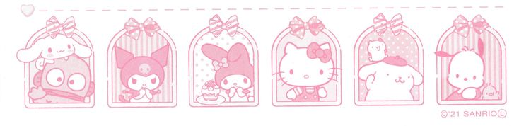

<!-- 

    

 -->

<h2 align="center" style="font-family:sans-serif; color:pink">HellOo! I am Melody 👩🏻‍💻💭</h2>

- 🔬 I'm currently study in **Institut Teknologi Sepuluh Nopember**, majoring in _Artificial Intelligence Engineering_
- 🖇️ I'm currently learning **Linux Ubuntu, Data Science, Machine Learning, and Deep Learning.**
- 💬 I'm opened for discussion about _math, code, problem-solving-things, design,_ and any other _scientific topics!_
- 🍥 Fun fact **I am a left-handed and I love sleep (psstt. . . ! I could sleep for 2 days straight if there's no deadline)**

<h4 align="left">Languages and Tools:</h3>

<picture data-importer="pacman">
  <source media="(prefers-color-scheme: dark)" srcset="https://raw.githubusercontent.com/tehsisrigulabatu/tehsisrigulabatu/pacman-output/pacman-contribution-graph-dark.svg?game=pacman">
  <source media="(prefers-color-scheme: light)" srcset="https://raw.githubusercontent.com/tehsisrigulabatu/tehsisrigulabatu/pacman-output/pacman-contribution-graph.svg?game=pacman">
  
</picture>

###